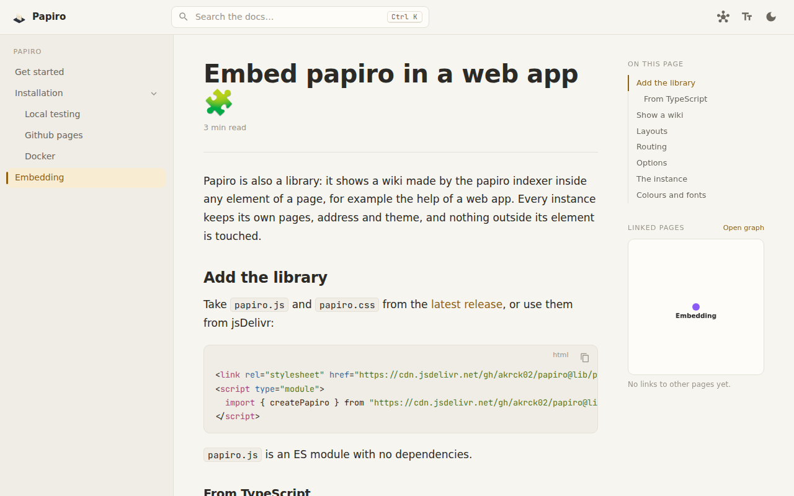
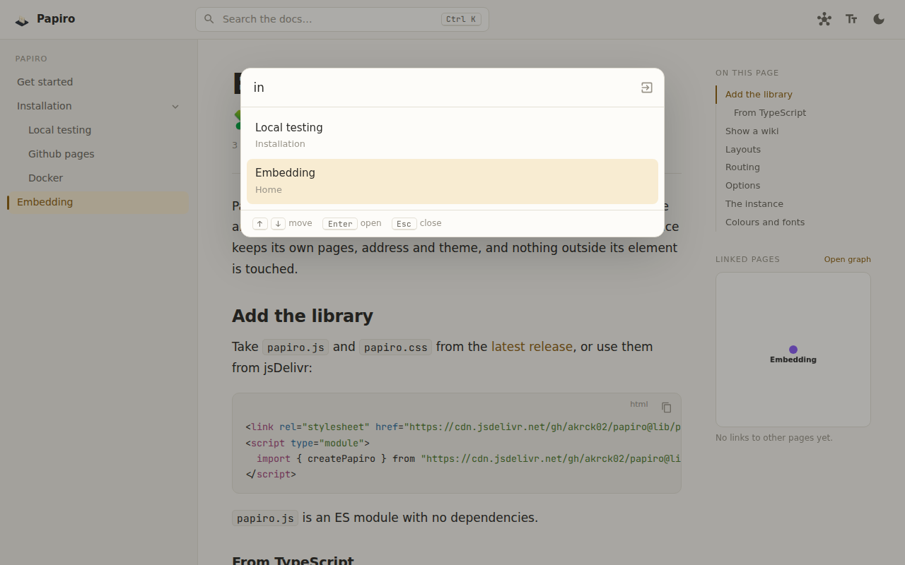
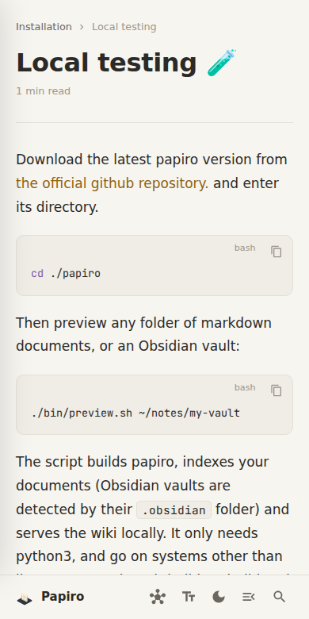

<div align="center">


# Papiro

**Markdown documents as a quiet, readable web wiki.**
Point it at a folder of Markdown (or an Obsidian vault) and it becomes a website with a menu,
search and a comfortable reading column. No server, no database: a GitHub Action publishes it to
GitHub Pages on every push.


[](LICENSE)

</div>

## 🤖 AI disclosure

This project was originally handcrafted. Since October 2026, Claude (Anthropic's AI assistant)
has helped with some changes under my direction: the Obsidian vault support, relative links,
the redesign and the update to the latest GTD.

Commits made with AI carry a `Co-Authored-By: Claude` line.

---

<p align="center">
<picture>
  <source media="(prefers-color-scheme: dark)" srcset="resources/readme/hero-dark.png">
  
</picture>
</p>

## ✨ What it looks like

<table>
<tr>
<th width="66%">Search with Ctrl K</th>
<th width="33%">On a phone</th>
</tr>
<tr>
<td>
<picture>
  <source media="(prefers-color-scheme: dark)" srcset="resources/readme/search-dark.png">
  
</picture>
</td>
<td>
<picture>
  <source media="(prefers-color-scheme: dark)" srcset="resources/readme/mobile-dark.png">
  
</picture>
</td>
</tr>
</table>

- A light and a dark theme, and a switch between the system font (the default) and papiro's serif reading fonts.
- A menu that follows your folders, with the current page marked. Start a file or folder name with
  a number (`1-intro.md`, `2-guides/`) to choose its place; the number is not shown.
- Search by page name from anywhere with `Ctrl K` (`Cmd K` on a Mac).
- An "On this page" index, the reading time, and links to the previous and next page.
- Code blocks with their language and a copy button, quotes and Obsidian callouts, images that
  zoom when clicked.

## 🚀 Quick start

Add this workflow to the repository that holds your documents, as
`.github/workflows/publish-docs.yaml`:

```yaml
name: Publish documents
on:
  push:
    branches: [main]
permissions:
  contents: write
jobs:
  build:
    runs-on: ubuntu-latest
    steps:
      - uses: actions/checkout@v5
      - uses: akrck02/papiro-deploy@main
        with:
          title: "My project"
          path: "./docs"             # the folder with your markdown documents
          isObsidianProject: false   # true for an Obsidian vault
      - uses: JamesIves/github-pages-deploy-action@v4
        with:
          branch: gh-pages
          folder: .
```

Then set GitHub Pages to publish the `gh-pages` branch. Every push to `main` rebuilds the site
with the latest papiro.

[All the options and the other ways to run it →](docs/01-get-started.md)

## 🔍 How it works

```
docs/*.md ──► papiro-indexer ──► resources/wiki/*.html + index.json ──► papiro (the web app)
```

1. [papiro-deploy](https://github.com/akrck02/papiro-deploy) downloads the latest papiro release.
2. [papiro-indexer](https://github.com/akrck02/papiro-indexer) turns each Markdown file into HTML,
   resolves relative links and images, converts Obsidian syntax when asked, and writes the
   `index.json` the menu and the search read.
3. Papiro, a small TypeScript library built on GTD, loads that index and shows each page. The
   papiro website is that library over the whole page; routing uses the URL hash, so any static
   host works.

## 🧩 Embed it in a web app

Papiro is also a library: the whole wiki, a single page or the graph inside any element, each
instance with its own pages, address and theme.

```ts
import { createPapiro } from "https://cdn.jsdelivr.net/gh/akrck02/papiro@lib/papiro.js";

await createPapiro("#docs", { source: "https://example.org/wiki", hashPrefix: "docs" });
```

[How to embed it →](docs/03-embedding.md)

## 👀 Preview your documents

Try papiro on a folder of Markdown or an Obsidian vault on your machine, nothing to install but
python3 (and go outside linux x86-64):

```bash
./bin/preview.sh ~/notes/my-vault    # http://127.0.0.1:8000, Obsidian vaults are detected
```

Run it again after changing your documents.

## 🛠️ Developing

Papiro needs no node to build: the binaries are in `bin`.

```bash
./bin/esbuild ./src/start.ts --bundle --tsconfig=tsconfig.json --outfile=./scripts/start.js
./bin/lit -f styles.env && cp styles/out/master.css styles/src/master.css
./bin/papiro-indexer -path ./docs -destination ./resources/wiki
python ./server-n-cache.py           # http://127.0.0.1:8000
```

To type check while developing, install the TypeScript native preview with `./bin/install-ts.sh`
and run `tsgo --noEmit`.

## 📚 Documentation

| | |
|---|---|
| [Get started](docs/01-get-started.md) | The ways to run papiro. |
| [GitHub Pages](docs/02-installation/02-github-pages.md) | Publish your documents with the papiro-deploy action. |
| [Docker](docs/02-installation/03-docker.md) | Serve a folder of documents from a container that indexes them as they change. |
| [Local testing](docs/02-installation/01-local-testing.md) | Preview a folder or an Obsidian vault on your machine. |
| [Embedding](docs/03-embedding.md) | Papiro as a library inside a web app: layouts, routing, options, colours. |

## Licence

MIT, see [LICENSE](LICENSE).
